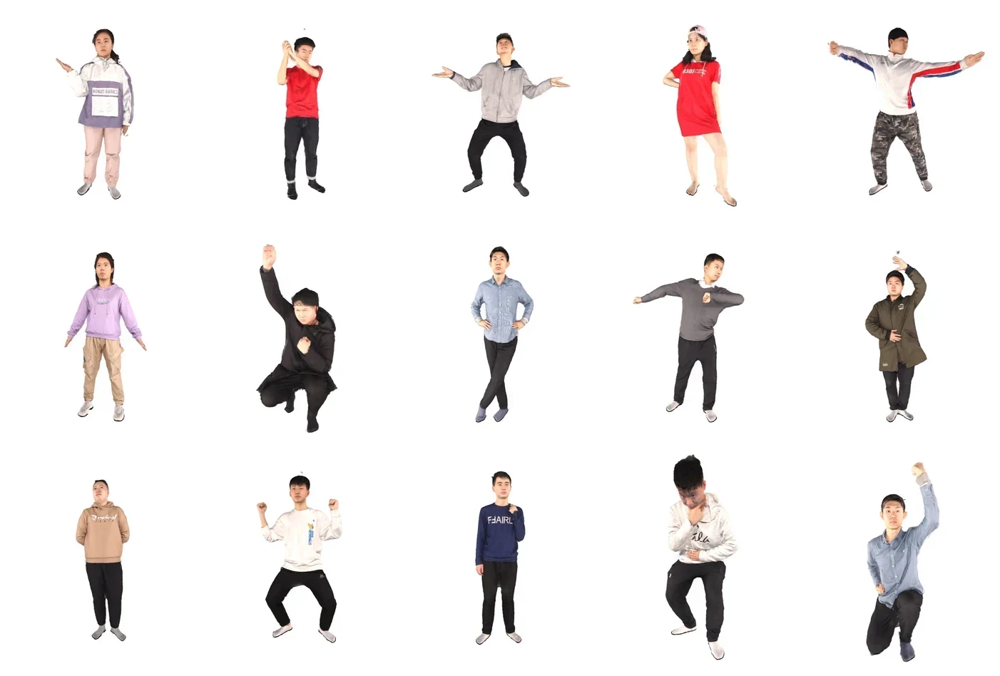
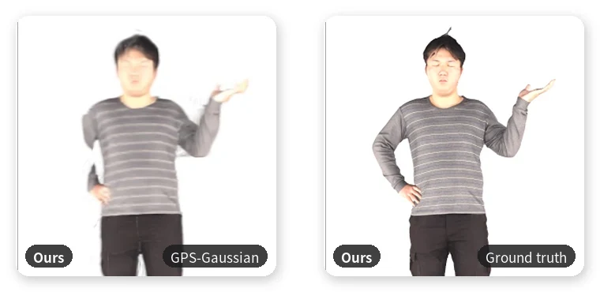
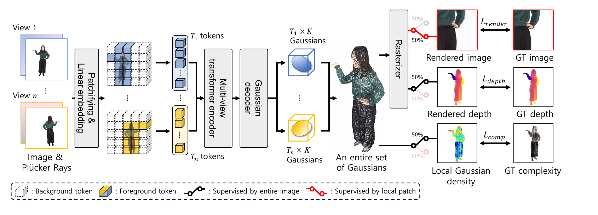

<h1 align="center">Complexity-guided Regularization for<br>Generalizable Human Gaussian Splatting</h1>

<p align="center">
Official PyTorch implementation of <br>
<strong>"Complexity-guided Regularization for Generalizable Human Gaussian Splatting"</strong>
</p>

<p align="center">
<a href="https://github.com/jerry-ryu">Gun Ryu</a>,
Gi-Mun Um,
Won-Sik Cheong,
<a href="https://sites.google.com/view/dcvl">Wonjun Kim</a> <strong>(Corresponding Author)</strong>
</p>

<p align="center">
  &nbsp; <strong><em>NeurIPS 2026 (Sydney)</em></strong> &nbsp;
</p>

<p align="center">
<a href="https://arxiv.org/abs/2610.35152"></a>
<a href="https://openreview.net/forum?id=zbm9QnDqWY"></a>
<a href="https://neurips.cc/virtual/2026/loc/sydney/poster/148201"></a>
<a href="https://youtu.be/TM3oHEoQnVs"></a>
</p>

<p align="center">
  
</p>
<p align="center">
  <em>Qualitative results of CGR-GS from 4 input views.</em>
</p>

<p align="center">
  
</p>
<p align="center">
  <em>Qualitative comparison with previous methods.</em>
</p>

<p align="center">
  
</p>
<p align="center">
  <em>Overall architecture of CGR-GS.</em>
</p>

---

## :eyes: Overview

**CGR-GS** is a feed-forward framework for **generalizable human Gaussian splatting** from sparse multi-view inputs.
Previous feed-forward methods place Gaussians on the pixel grid or on the skinned mesh template, so the Gaussian density is unrelated to the visual complexity of the subject, which blurs fine details such as fingers, faces and textured clothes.

We define a **complexity prior** per vertex of the clothed human mesh as the local entropy of its geometric (normal) and textural (color) characteristics, and use it in two ways:

- **Complexity-guided regularization**: a 3D offset head lets every Gaussian leave its pixel patch, and placement losses make the local Gaussian density on the surface increase with the complexity prior.
- **Complexity-aware patch sampling**: local training patches are sampled with probability proportional to the complexity, so intricate regions receive sufficient supervision.

### Highlights

- 🚀 Feed-forward human Gaussian splatting from 4 sparse views at real-time inference speed
- 🧭 Complexity prior from local geometric and textural entropy of the human mesh
- 🎯 Gaussian density regularized to follow the complexity prior
- 🔍 Complexity-aware local patch supervision for fine-grained details
---

## 📦 Installation

### 1) Clone
```bash
git clone https://github.com/DCVL-3D/CGR-GS_release.git
cd CGR-GS_release
```

### 2) Create environment + install dependencies
```bash
bash install.sh
```

This will:
- create a conda env (`CGR-GS`, Python 3.10)
- install **PyTorch 2.5.0 + CUDA 12.4**, xformers
- install Python deps via `requirements.txt`
- build/install `./submodules/diff-gaussian-rasterization/`
---

## 🗂️ Dataset

Please request and download the official **THuman2.0** dataset.
The request form is available here: [THuman2.0 Agreement Form](https://github.com/ytrock/THuman2.0-Dataset/blob/main/THUman2.1_Agreement.pdf)

We use subjects `0000`–`0425` for training and `0426`–`0525` for evaluation. Place the raw scans as follows:

```text
data/thuman2.0_raw/
├── train/<id>/{<id>.obj, material0.jpeg, material0.mtl}
└── val/<id>/{<id>.obj, material0.jpeg, material0.mtl}
```

### 1) Complexity prior
```bash
python prepare_data/complexity.py --raw_root data/thuman2.0_raw
```

### 2) Rendering
```bash
bash prepare_data/run_render.sh
```

Resulting structure:
```text
data/thuman2.0_rendered/{train,val}/
├── img | mask | depth | img_comp | img_comp_geo | img_comp_tex/<id>_<cam>/LR/<vid>.png
└── parm/<id>_<cam>/LR/<vid>_{intrinsic,extrinsic}.npy
```

---

## 🧪 Evaluation

Set the dataset path in `config/dataset/thuman.yaml`.

Download the pretrained checkpoint `CGR_thuman2.0.ckpt` from [here](https://github.com/DCVL-3D/CGR-GS_release/releases/download/v1.0/CGR_thuman2.0.ckpt) and put it under `checkpoints/`.

Novel view synthesis on the 100 evaluation subjects (4 source views, 16 target views):
```bash
bash scripts/test.sh checkpoints/CGR_thuman2.0.ckpt
```
Add `true` as the second argument to also save the rendered images under `outputs/`.

| THuman2.0 | PSNR | SSIM | LPIPS |
|:--|:--:|:--:|:--:|
| `CGR_thuman2.0.ckpt` | 32.42 | 0.9766 | 0.0201 |

---

## License

This project is licensed under the **Apache License 2.0**, with the exception of certain components derived from or influenced by third-party projects. See [LICENSE](./LICENSE) and [LICENSE-THIRD-PARTY.md](./LICENSE-THIRD-PARTY.md).

- **Apache License 2.0**: All original code written for this repository is released under the Apache 2.0 license.
- **Gaussian Splatting**: The rasterizer under `submodules/` is adapted from [Gaussian Splatting](https://repo-sam.inria.fr/fungraph/3d-gaussian-splatting/), which is licensed for **non-commercial research use only**. Please check the original project page and related license terms before use.

This repository is intended for **academic research purposes**. Users are responsible for checking and complying with the licenses of all included or referenced third-party components.

## Citation
If you use this codebase, please cite our paper:
```bibtex
@inproceedings{ryu2026cgrgs,
    author    = {Ryu, Gun and Um, Gi-Mun and Cheong, Won-Sik and Kim, Wonjun},
    title     = {Complexity-guided Regularization for Generalizable Human Gaussian Splatting},
    booktitle = {Advances in Neural Information Processing Systems (NeurIPS)},
    year      = {2026}
}
```
